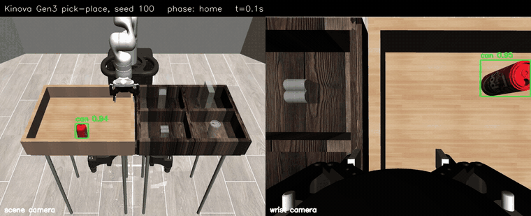
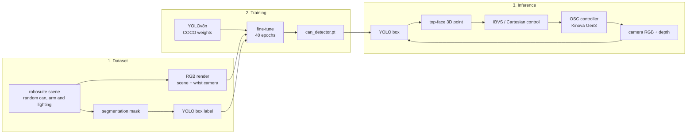
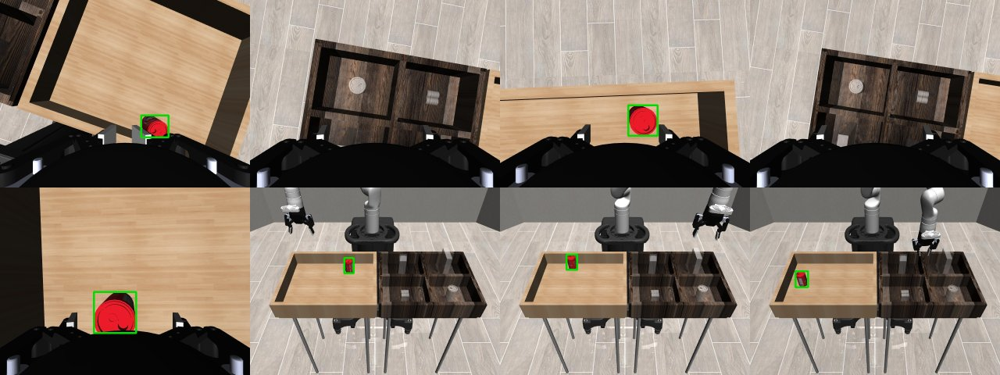
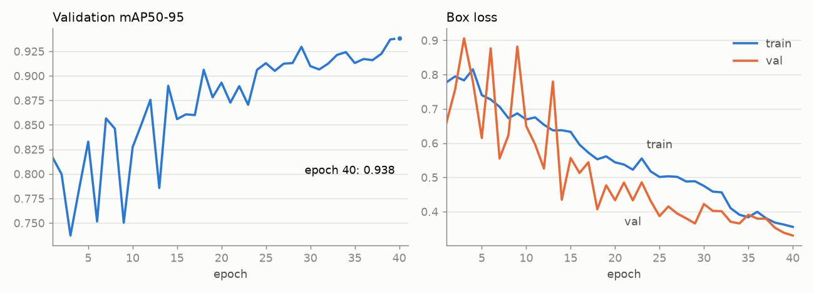
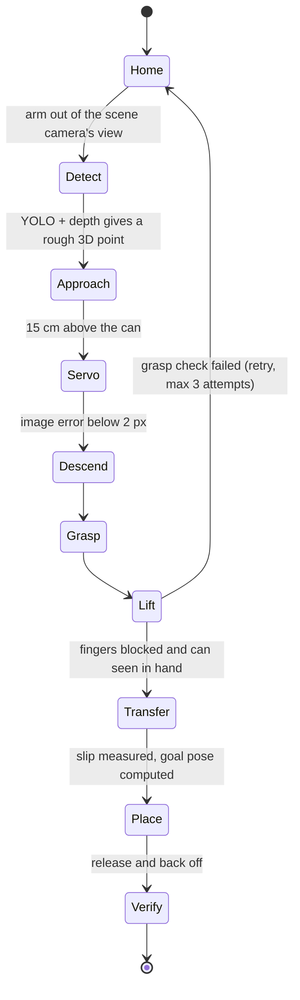
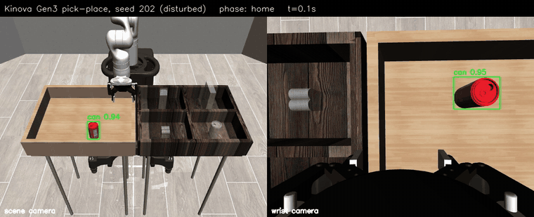

# Kinova Gen3 pick and place with YOLOv8n and visual servoing

A Kinova Gen3 arm in robosuite finds a can with a camera, servos onto it using the
wrist camera, picks it up and puts it in the target bin. Detection is a YOLOv8n
model fine-tuned on images rendered from the simulator.



*Left: fixed scene camera. Right: wrist camera. The white cross is the tracked can,
the yellow cross is where it has to be in the image for the gripper to be centred on it.*

## Overview

- **Task:** robosuite `PickPlaceCan` (one object, one task), with the Kinova Gen3 (`Kinova3`) and a Robotiq 85 gripper.
- **Detection:** YOLOv8n, fine-tuned from COCO weights on one dataset of 1,600 simulator images, all of a single class (`can`).
- **3D localisation:** each YOLO box is turned into a 3D point on the can's top face using the depth image and the camera pose.
- **Visual servoing:** image-based visual servoing (IBVS) with the wrist camera, running YOLO at every 20 Hz control step.
- **Grasp and place:** chains rigid transforms (`T_world_goal * inv(T_grip_obj)`) to work out the gripper pose that puts the can on the goal.
- **Checks:** the grasp is checked with the finger angle and the camera, and the placement is checked with the camera at the end. A failed grasp is retried.
- **Results:** 30/30 successes on unseen seeds, and 20/20 when the can is pushed 4 cm while the arm is servoing.

## Pipeline



## Dataset

There's no hand labelling. `scripts/01_generate_dataset.py` places the can and the arm at
random, renders an image from either camera, and takes the box from MuJoCo's
segmentation mask, so every label is pixel-exact.



| split | images | wrist camera | scene camera | no can visible |
|---|---|---|---|---|
| train | 1200 | 776 | 424 | 207 |
| val | 200 | 143 | 57 | 41 |
| test | 200 | 136 | 64 | 36 |

- **Image size:** 640x480. The wrist camera is used about 65% of the time, because that's the view the servo loop depends on.
- **Can placement:**
  - 66% in the pick bin (10% of these lying on their side)
  - 14% held in the gripper
  - 12% in the goal bin
  - 8% with no can in the scene
- **Arm pose:** in 55% of images the gripper is near the can, from touching distance to 24 cm above it (the poses seen while servoing). The rest are random poses over both bins. A small random tilt and yaw is added to the gripper.
- **Lighting:** brightness is scaled by 0.6 to 1.3.
- **Ghost can:** robosuite draws a grey "ghost" can in the goal bin as a marker. It is never labelled, so the model learns to ignore it.
- **Box size:** 1,316 boxes, median 52x50 px (from 4 px for a sliver at the image edge up to 190 px close to the wrist camera).
- **Visibility:** an image only gets a box if at least 60 can pixels are visible.

The splits use different random seeds. The dataset takes about a minute to generate and
is not committed (137 MB). Run the script to get it back.

## Training

`scripts/02_train_yolo.py` fine-tunes `yolov8n.pt` with Ultralytics:

| setting | value |
|---|---|
| epochs | 40 (early-stopping patience 15, not triggered) |
| image size / batch | 640 / 16 |
| optimiser | AdamW, lr 0.002 (Ultralytics `auto`) |
| augmentation | Ultralytics defaults, hue jitter 0.01, rotation ±5°, mosaic off for the last 8 epochs |
| hardware / time | Apple M-series GPU (`mps`), 29 minutes |



Results on the 200 held-out test images:

| precision | recall | mAP50 | mAP50-95 |
|---|---|---|---|
| 0.992 | 0.982 | 0.994 | 0.934 |

The script also accepts `--model yolo11n.pt`. I've only trained and tested v8n.

## Inference



1. **Detect.** The arm moves out of the way and YOLO runs on the scene camera. The depth pixels inside the box are back-projected to world points, and the top face is the band of points just under the highest one. Its centre is the rough can position, taken as the median over 5 frames.
2. **Approach.** A Cartesian move to 15 cm above that point, so the can is in the wrist camera's view.
3. **Visual servo.** The feature is the can's top-face centre in the wrist image, with depth `Z` from the depth map. The wrist camera sits 5 cm off the gripper axis, so the target feature isn't the image centre: it is the projection of the gripper axis at depth `Z`, `s* = (X, Y) / Z`, which shifts as the arm descends. With the point-feature interaction matrix (`L_xy = -I/Z`, `L_z = s/Z`), the control law sets `ė = -λe`, with λ = 2.5. It drives `x, y` while the descent speed is damped by `exp(-|e|²/σ²)`, so the arm only comes down once it's lined up. The loop stops 21 cm from the can (camera to top face), because any closer and the hand blocks the view.
4. **Descend and grasp.** The last 11 cm go straight down to the servoed point. The gripper closes, and `T_grip_obj` is stored from the perceived can pose and the arm's kinematics.
5. **Grasp check.** After lifting, the finger angle has to be below 0.45 rad (0.51 means it closed on air, about 0.39 means it's holding the can). YOLO also has to see the can where `T_grip_obj` predicts it. If either check fails, the arm goes back to Home and tries again.
6. **Transfer and place.** The can slides 5 to 20 mm down in the fingers while it's carried. Over the goal, the wrist camera measures how far it has slipped and `T_grip_obj` is corrected. Then `T_world_grip = T_world_goal * inv(T_grip_obj)`, the arm descends, and the can is released.
7. **Verify.** The wrist camera checks that the can ended up within 4 cm of the goal.

The controller only gets camera images, depth, camera poses, joint and gripper state, and
the goal position. It never reads the can's true pose from the simulator. That's only used
in `01_generate_dataset.py` for labels and in `03_run_pick_place.py` for scoring.

### Control details

- **Velocity commands:** robosuite's OSC controller takes deltas relative to the current pose. Small deltas got eaten by the arm's compliance, so the servo velocity is integrated into a reference position (clamped to 4 cm ahead of the arm), and OSC tracks that reference.
- **Point-to-point moves:** these have a small integral term against steady-state sag, and the holds keep it, so the arm doesn't droop while the gripper opens.
- **Stiffness:** OSC `kp` is 300 instead of robosuite's default 150.

## Results

Seeds that weren't used for tuning. Success is robosuite's own `_check_success()`.

| | nominal (seeds 100-129) | can pushed 4 cm during servoing (seeds 200-219) |
|---|---|---|
| success | 30/30 | 20/20 |
| first attempt | 30/30 | 19/20 |
| scene-camera estimate error, median / max | 1.9 / 37.0 mm | 1.9 / 33.1 mm |
| error after servoing, mean / max | 1.2 / 1.5 mm | 1.2 / 1.6 mm |
| placement error, mean / max | 6.1 / 16.6 mm | 5.9 / 11.5 mm |
| simulated time per episode | 19.5 s | 19.7 s |

- **Large scene-camera errors (25 to 37 mm):** these come from cans near the front wall of the bin, which hides part of the can from the scene camera. Servoing brings them down to about 1 mm.
- **The one retry:** a servo timeout on a can in the far corner.
- **Per-episode numbers:** in `results/*_metrics.json`.

With `--disturb` the can is pushed 4 cm while the arm is already tracking it:



## Setup

Tested on macOS (Apple silicon) with Python 3.11.

```bash
python3.11 -m venv .venv
source .venv/bin/activate
pip install -r requirements.txt
```

MuJoCo is pinned to 3.3.0: robosuite 1.5.2 crashes on MuJoCo 4 (`get_joint_qpos_addr`
fails on the joint-type check).

## Usage

```bash
python scripts/01_generate_dataset.py                 # dataset -> data/can
python scripts/02_train_yolo.py                       # -> models/can_detector.pt (already included)
python scripts/03_run_pick_place.py --video           # one episode, mp4 in results/videos
python scripts/03_run_pick_place.py --seed 100 --episodes 30
python scripts/03_run_pick_place.py --seed 200 --episodes 20 --disturb
```

To turn a video into a GIF like the ones above:

```bash
ffmpeg -i results/videos/nominal_seed100.mp4 -vf "setpts=PTS/1.5,fps=10,scale=760:-1,split[a][b];[a]palettegen=max_colors=128[p];[b][p]paletteuse" demo.gif
```

## Project layout

```
vspnp/
  env.py          robosuite env with the moved robot base, constants
  camera.py       pinhole model, projection, transforms
  perception.py   YOLO wrapper + depth refinement to a 3D top-face point
  robot.py        Cartesian / velocity control on top of OSC
  controller.py   state machine, IBVS, grasp check, slip estimate, placing
  kinematics.py   damped least-squares IK (only for posing the arm in the dataset)
scripts/
  01_generate_dataset.py
  02_train_yolo.py
  03_run_pick_place.py
models/can_detector.pt   trained YOLOv8n weights (6.5 MB)
results/                 metrics from the runs above
assets/                  images and GIFs for this README
```

## Notes and limitations

- **Robot base moved.** robosuite mounts the arm at (-0.50, -0.10). From there the Gen3 can't reach the goal compartment with the gripper pointing down. I swept mount positions with IK and moved it to (-0.32, -0.02).
- **macOS rendering.** If torch or Ultralytics get loaded, numba compiles, or YOLO runs for the first time after MuJoCo has created its OpenGL context, every frame from then on comes back as noise or black. `vspnp/__init__.py` imports torch and Ultralytics first, `make_env()` warms up numba and hard-resets, and the detector is always created before the env. If you write your own script, keep that order or call `env.reset()` after creating the detector.
- **Simulation only.** Depth, camera intrinsics and the hand-eye transform are exact. A real setup would need calibration, real training images and a noisier depth filter.
- **Same simulated scene throughout.** The detector was trained and tested on renders of this one scene, so the test score says nothing about real images.
- **Known can.** Assumes one standing can of known height and a known goal position.
- **Final descent isn't tracked.** The last ~11 cm before the grasp aren't visually tracked. If the can moves then, the grasp check catches it and the arm retries.
